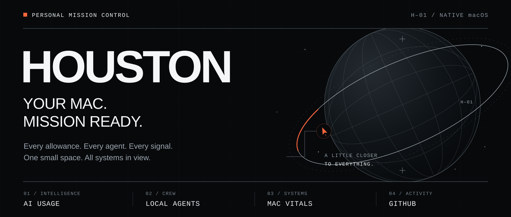
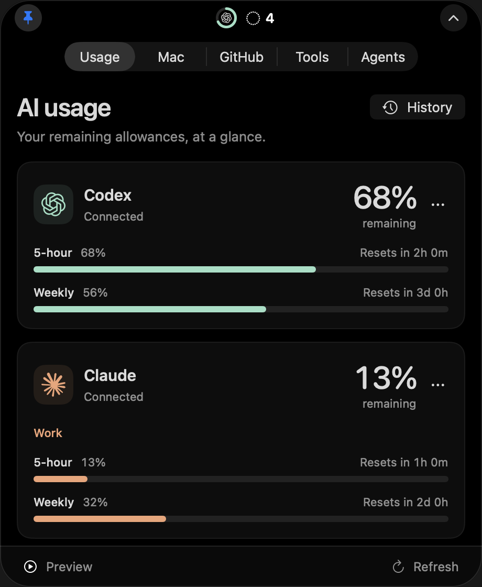
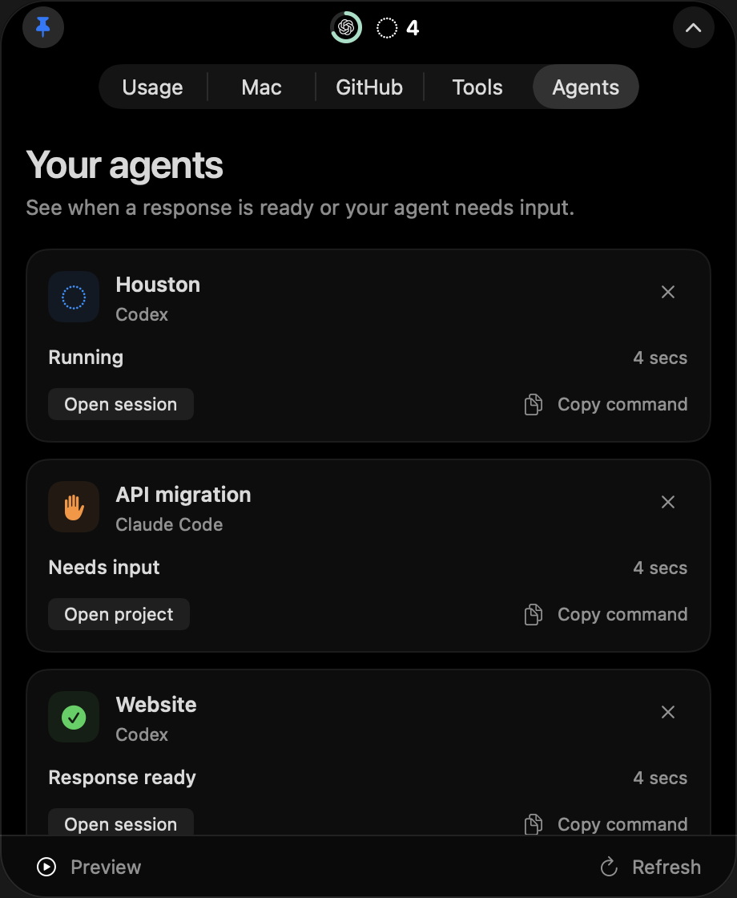

<p align="center">
  
</p>

<h1 align="center">Mission control. In your notch.</h1>

<p align="center">
  Your AI allowances. Your agents. Your Mac. Your work.<br>
  One native companion, always within reach.
</p>

<p align="center">
  <a href="#run"><strong>Build Houston ↗</strong></a> &nbsp; · &nbsp;
  <a href="#mission-control">Explore the systems</a> &nbsp; · &nbsp;
  <a href="docs/flight-manual.md">Flight manual</a>
</p>

<p align="center">
  <code>macOS 14+</code> &nbsp; <code>Swift 6.2+</code> &nbsp; <code>Apple Silicon + Intel</code>
</p>

---

<a id="mission-control"></a>

## 01 / All systems in view

Houston brings AI usage, local agent sessions, system vitals, GitHub activity, and project tools to the top of your screen. Hover to expand. Move away to collapse. Pin it when you want to stay awhile. On displays without a notch, Houston lives in a floating pill below the menu bar.

<p align="center">
  
  &nbsp;
  
</p>

<p align="center"><sub>Native app renders with illustrative accounts, usage, and sessions.</sub></p>

| System | What comes into view |
| :--- | :--- |
| **AI telemetry** | Allowances and reset countdowns across seven integrations. Favorite up to four providers for the compact island. Explore local 7- and 30-day history, plus named Claude, Cursor, and OpenRouter accounts. |
| **Agent comms** | Follow local Claude Code, Codex, and Cursor sessions. See supported working, needs-input, and response-ready events, with island moments and optional notifications. Requires connected lifecycle hooks; coverage varies by agent. |
| **Mac vitals** | CPU, GPU, memory, thermals, fans, power, battery, and storage. Available sensors refresh every two seconds while the Mac tab is open. |
| **GitHub radar** | Your pull requests, review requests, and unread notifications. Watch a repository for PRs and Actions runs. Read-only, with opt-in check and review alerts. |
| **Projects** | Saved folders with editor/Terminal links, Git status, local ports, selected command execution, and Docker controls. Connect Vercel deployments, Sentry issues, and assigned Linear work. Use the notch or a larger Projects window. |
| **Drop shelf** | Drag files or folders onto the island to hold them, then drag one or all into Finder or another app. The compact island shows the held count. Clear removes references only; items are held until you quit Houston. |

Missing data stays missing. Earlier readings are labeled. **Preview** is explicit sample data. “Response ready” means the agent’s response ended; it does not certify that the task succeeded.

<a id="run"></a>

## 02 / Go for launch

You’ll need **macOS 14 or newer** and a **Swift 6.2+ toolchain**. Build from source:

```sh
git clone https://github.com/FayezBast/houston.git
cd houston
bash scripts/build.sh
open dist/Houston.app
```

The build produces a universal Apple Silicon + Intel app. Place `Houston.app` in its final location before connecting agent hooks or the Claude terminal bridge; those connections store its executable path.

1. Open **Tools → Providers** and connect the accounts you use.
2. Star up to four providers to keep their allowances in the compact island.
3. Open **Agents → Connect** to install local status hooks. Review `/hooks` in Claude Code/Codex or **Customize → Hooks** in Cursor; follow the displayed restart guidance.
4. Configure alerts in **Tools → Notifications**. macOS notifications are opt-in; island sounds are on by default and can be switched off there.
5. Open **Projects** to add a folder and saved commands. Cloud tokens and project mappings are optional. [Projects setup →](docs/projects.md)

**Local build status:** Houston is ad-hoc signed and not notarized by default. A rebuild can require an explicit **Check connection** to restore Keychain access. Launch at login and automatic updates are not included. Intel builds are produced, but Intel hardware validation remains outstanding. See [signing and distribution](docs/flight-manual.md#distribution).

<a id="providers"></a>

## 03 / Assemble your crew

Enable the integrations you use under **Tools → Providers**. Allowances refresh every five minutes or on demand; availability depends on the provider, plan, and sign-in.

| Integration | Connection | Flight notes |
| :--- | :--- | :--- |
| **Codex** | Existing Codex CLI sign-in | Reads app-server rate limits. |
| **Claude Code** | Claude browser account, Claude Code sign-in, or terminal bridge | The bridge reports after a terminal response; the desktop app does not feed it. |
| **Cursor** | Browser session or Cursor.app sign-in | Shows the quotas returned by Cursor’s dashboard. |
| **GitHub Copilot** | `gh auth login` | Some plans or credentials do not expose quotas. |
| **Gemini** | Eligible Code Assist account | Consumer CLI OAuth is unsupported; see [eligibility notes](docs/usage-integrations.md#gemini-consumer-account-limitation). |
| **Windsurf** | Local SQLite plan cache | Always labeled cached. Open Windsurf to populate it. |
| **OpenRouter** | API key saved in Keychain | Key spending and optional key budget; not account balance. |

Codex, Claude, Cursor, and Copilot quota readings have recorded live verification on the development Mac. Gemini was tested with simulated responses; Windsurf and OpenRouter still need live verification here. The new project integrations and Cursor lifecycle adapter have fixture-backed tests; their external connections still need verification in your environment. [Connection details and limitations →](docs/flight-manual.md#usage-and-tools)

<a id="controls"></a>

## 04 / You have the controls

The island starts compact and unpinned. Hover to open; leaving closes it after 350 ms. Favorites rotate every six seconds. Agent activity surfaces beside the camera, and alerts can briefly expand the island to bring the relevant signal into view.

| While Houston is focused | Action |
| :--- | :--- |
| <kbd>⌘</kbd> <kbd>O</kbd> | Show Houston |
| <kbd>⌘</kbd> <kbd>P</kbd> | Toggle pinning |
| <kbd>⌘</kbd> <kbd>1</kbd>–<kbd>7</kbd> | Usage · Mac · GitHub · Tools · Agents · Projects · Drop |
| <kbd>⌘</kbd> <kbd>0</kbd> | Open Projects window |
| <kbd>⌘</kbd> <kbd>R</kbd> | Refresh |
| <kbd>⌘</kbd> <kbd>,</kbd> | Open Tools |
| <kbd>Esc</kbd> | Dismiss |

Click the menu-bar icon to toggle the panel; right-click to quit. Houston supports Reduce Motion, Increase Contrast, and VoiceOver descriptions for compact readings. [Appearance and accessibility →](docs/flight-manual.md#appearance-and-accessibility)

## 05 / Ground rules

- **Credentials in Keychain.** Browser sign-in imports happen only when connecting. Houston leaves browser storage unchanged and saves the verified session for later refreshes.
- **History on your Mac.** Usage observations stay local for up to 90 days. Agent records contain session metadata, without prompts, transcripts, or tool output.
- **Your tools stay in your control.** GitHub access is read-only. Agent setup preserves existing hooks and permissions; it does not approve tools or bypass trust.
- **Commands run when selected.** Saved project commands execute only when you press Run. Closing the panel keeps them running; quitting Houston stops its owned command groups. Cloud project integrations are read-only.
- **Work follows visibility.** Mac sensors stop sampling when their tab closes. Usage keeps its five-minute cadence; GitHub background monitoring depends on enabled notifications. Some agent events may be unavailable, and GitHub alerts use polling.

<a id="documentation"></a>

## 06 / Flight manual

| Destination | What you’ll find |
| :--- | :--- |
| [Full flight manual](docs/flight-manual.md) | Setup, appearance, provider connections, Mac sensors, GitHub, resource measurements, and distribution. |
| [Agent sessions](docs/agent-sessions.md) | Hook installation, status meanings, island moments, and session links. |
| [Projects and developer tools](docs/projects.md) | Folders, commands, local servers, Docker, cloud connections, notifications, and verification limits. |
| [Accounts](docs/accounts.md) | Work and personal accounts, identity, and Keychain setup. |
| [Usage history](docs/usage-history.md) | Retention, charts, quota alerts, and pace estimates. |
| [Integration notes](docs/usage-integrations.md) | Provider data sources, browser imports, and account eligibility. |

<a id="verify"></a>

## 07 / On the ground

Built with **Swift, SwiftUI, and AppKit**, with [SweetCookieKit](https://github.com/steipete/SweetCookieKit) for browser-session imports.

Run the tests with access to the macOS display:

```sh
CLANG_MODULE_CACHE_PATH="$PWD/.build/ModuleCache" \
  swift test --disable-sandbox --cache-path "$PWD/.build/cache"
```

Inspect live sources without opening the panel:

```sh
dist/Houston.app/Contents/MacOS/Houston --check-usage
dist/Houston.app/Contents/MacOS/Houston --check-system
dist/Houston.app/Contents/MacOS/Houston --check-github
```

<details>
<summary><strong>Signing, diagnostics, and recorded verification</strong></summary>

<a id="distribution"></a>

For durable Keychain grants across updates, use an existing stable signing identity:

```sh
HOUSTON_SIGNING_IDENTITY="Developer ID Application: …" bash scripts/build.sh
```

Use `--check-usage cursor` to inspect one provider, `--check-github-alerts` to diagnose PR checks and reviews without sending notifications, and `bash scripts/measure.sh` to measure the running app.

Historical performance figures have specific hardware and version limits. See [resource use](docs/flight-manual.md#resource-use) and [recorded verification](docs/flight-manual.md#verify) for context.

</details>

---

<p align="center">
  <strong>HOUSTON</strong><br>
  <sub>YOUR MAC. MISSION READY.</sub><br><br>
  <a href="THIRD_PARTY_NOTICES.md">Third-party notices</a> &nbsp; · &nbsp;
  <a href="https://github.com/FayezBast/houston/issues">Report an issue</a> &nbsp; · &nbsp;
  <a href="#run">Go for launch ↑</a>
</p>
